

Bharat AI-SoC Student Challenge · Problem Statement 5

<h1 class="title">Pharma Inspector*</h1>

Offline AI tablet inspection on an Android phone · Final Project Report · Built with Llama

## Executive Summary

Pharma Inspector turns an ordinary Android phone into an offline inspection station for loose tablets. The
phone camera looks at a tray, a vision model finds and scores every tablet, calibrated rules give each one a
verdict, and Llama 3.2 running on the same phone explains the verdict to the operator in plain language. No
cloud, no GPU and no network permission are used.

0.95

F1 on held-out images, measured on the phone

51 ms

vision per tablet (median)

~5 s

Llama advice per flagged tablet

0

network permissions in the app

| Goals | How the project meets them |
|---|---|
| Detect defective tablets reliably | PatchCore-lite anomaly detector, calibrated on separate data, evaluated once on held-out images |
| Run in real time on a phone | Both models on the phone CPU; a 9-tablet tray is decided in under one second |
| Give the operator useful advice | Llama 3.2 1B on ExecuTorch explains each flagged tablet in four short lines |
| Make the operator's job easy | Clear verdict banner, labelled boxes, per-item cards, local log with CSV export |

<figure>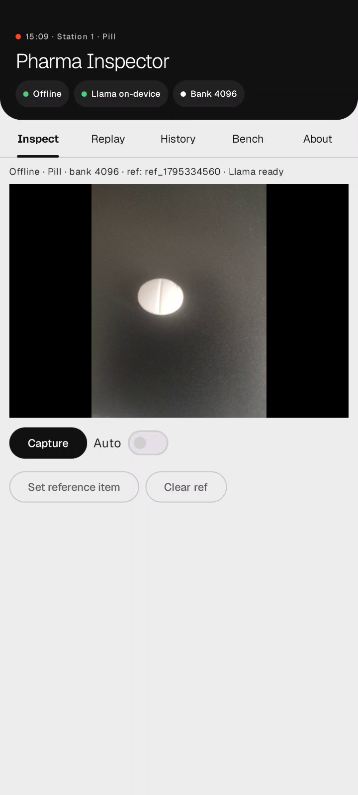<figcaption>Live camera</figcaption></figure>
<figure>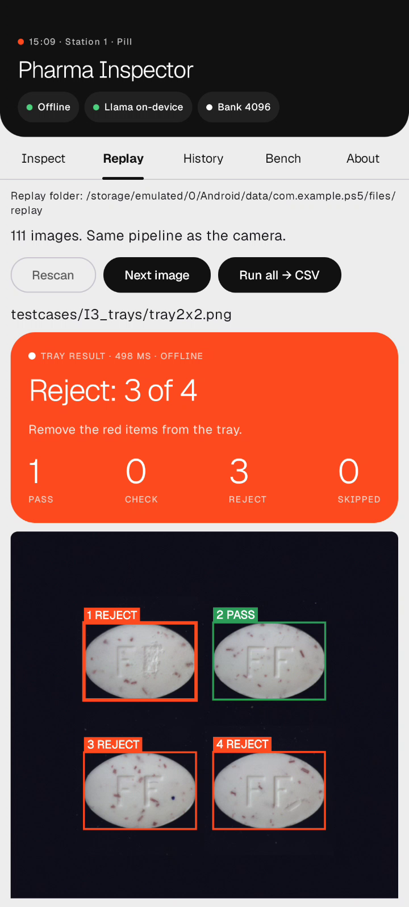<figcaption>Tray verdict</figcaption></figure>
<figure>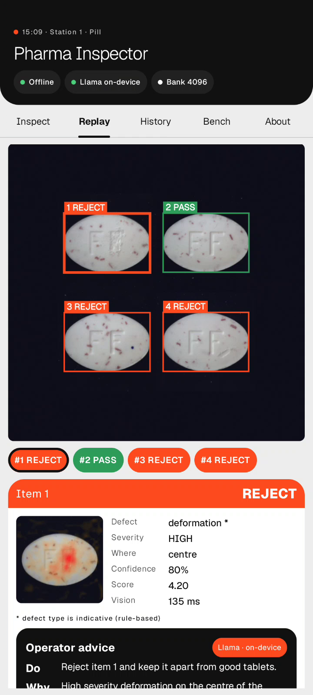<figcaption>Defect and Llama advice</figcaption></figure>
<figure>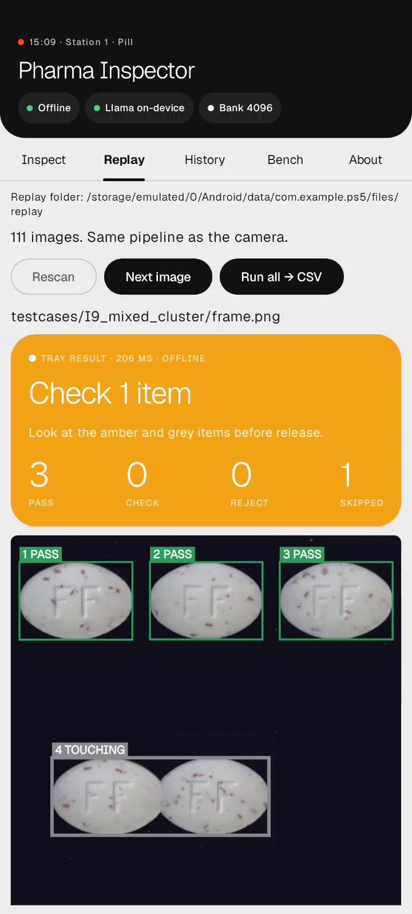<figcaption>Touching tablets flagged</figcaption></figure>
<figure>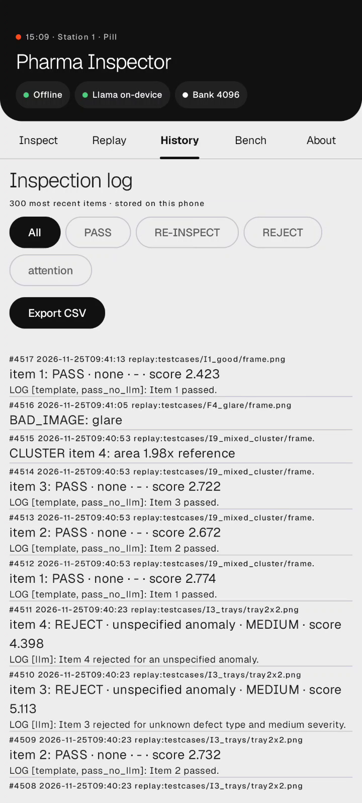<figcaption>Inspection log</figcaption></figure>

*Top: replay of MVTec test images. Bottom: the live phone camera on real paracetamol tablets.*

<figure>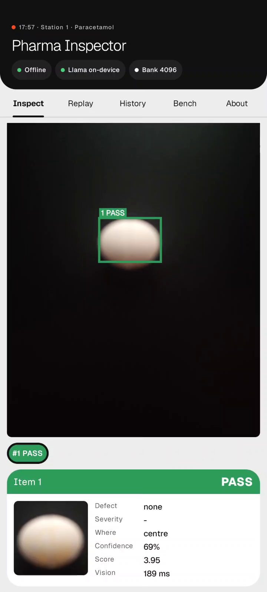<figcaption>Live: good tablet passes</figcaption></figure>
<figure>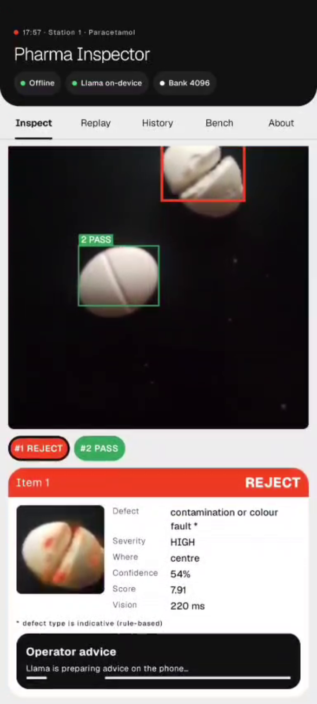<figcaption>Live: good and broken</figcaption></figure>
<figure>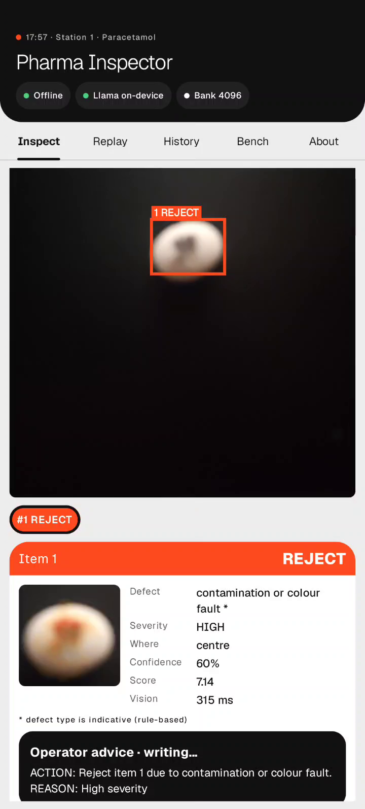<figcaption>Live: ink mark found</figcaption></figure>
<figure>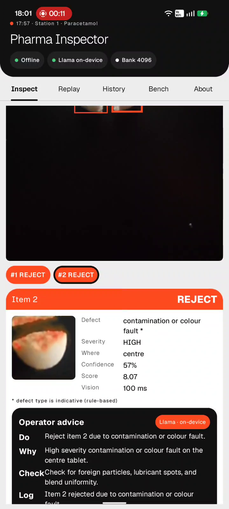<figcaption>Live: Llama advice</figcaption></figure>
<figure>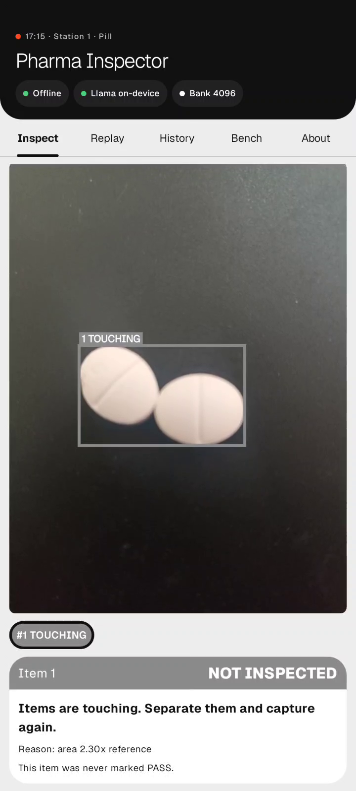<figcaption>Live: touching tablets</figcaption></figure>

## Scope

The station works in stop-and-shoot mode: the operator places a tray on a matte dark surface under a fixed
phone, and the app inspects once the scene is still (or on a button press).

Deliverables

- Android app with camera and replay modes, per-item verdicts, severity, confidence and advice
- Vision model (ONNX Runtime) and Llama 3.2 1B (ExecuTorch), both running on the phone
- Local inspection log with CSV export, and a benchmark screen for on-device measurements
- Source code, scripts that regenerate every result, this report and a demo video

Out of scope: moving conveyors at line speed, stacked tablets, underside defects, blister packs and rejection
hardware. The app alerts and logs; it does not move tablets.

## Methodology

The system has two separate pipelines that meet at one JSON record.

| Stage | What happens |
|---|---|
| 1. Quality gate | Frames that are too dark, too bright, glared or blurred are refused before any model runs |
| 2. Item finder | OpenCV finds each tablet; touching, cut-off, unknown or extra items are marked and never passed |
| 3. Vision model | Each tablet is rotated, cropped to 256 x 256 and scored by PatchCore-lite, which also returns a defect heatmap |
| 4. Decision rules | Calibrated thresholds give PASS, RE-INSPECT or REJECT, plus severity (Low, Medium, High) and confidence |
| 5. Hand-off | One JSON record per flagged tablet: verdict, defect type, severity, confidence, location, box |
| 6. Advisory | Llama 3.2 1B writes four lines (Do, Why, Check, Log); a validator checks them, otherwise a template is used |

### Vision pipeline

- **Model:** PatchCore-lite. ResNet-18 features from two layers, projected to 128 dimensions and compared with a
  memory bank of normal patches. It learns from good tablets only, so it needs no defect labels.
- **Runtime:** ONNX Runtime Android 1.23.2 on the CPU, 4 threads, one tablet at a time.
- **Data:** MVTec AD `pill`. Training uses good images only; thresholds use a separate calibration split; all
  accuracy numbers come from a held-out evaluation split used once for the final configuration.
- **Verdict:** below `t_pass` is PASS, above `t_reject` is REJECT, in between is RE-INSPECT. Severity comes from
  defect size and type. Defect type is indicative and rule-based.

### Advisory pipeline

- **Model:** Llama 3.2 1B Instruct, exported with ExecuTorch 1.5.1 for the XNNPACK CPU backend.
- **Input:** the JSON record only. Llama never sees images and never changes the verdict.
- **Output:** four labelled lines. The first line always starts with the action set by the rules (Reject,
  Re-inspect, Release), so the advice cannot contradict the decision.
- **Safety net:** each answer is checked for format, length, the right action word, no invented numbers and no
  made-up re-inspection results. Anything that fails is replaced by a fixed template, and the log records why.
- **Flow:** only flagged tablets go to Llama, through a small queue that handles rejects first.

## Results

### Detection accuracy (on the phone)

<!-- BEGIN:detection -->
Held-out evaluation split, run once on the phone (memory bank 4096). A tablet counts as flagged when its verdict is RE-INSPECT or REJECT. Source: `results/detection_eval_device.json`.

| metric | value |
|---|---|
| images (defective / good) | 86 (73 / 13) |
| precision | 0.958 |
| recall | 0.945 |
| F1 | 0.952 |
| image AUROC | 0.940 |
| miss rate | 0.055 |
| false-alarm rate | 0.231 |
| TP / FP / FN / TN | 69 / 3 / 4 / 10 |
| not inspected | 0 |

Verdicts:

| truth | PASS | RE-INSPECT | REJECT |
|---|---|---|---|
| good | 10 | 2 | 1 |
| defective | 4 | 12 | 57 |
<!-- END:detection -->

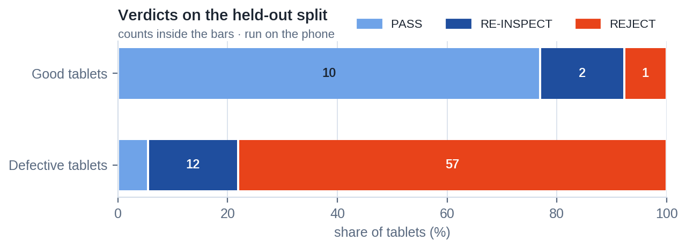

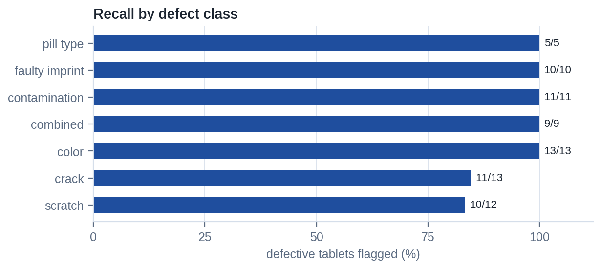

### Speed

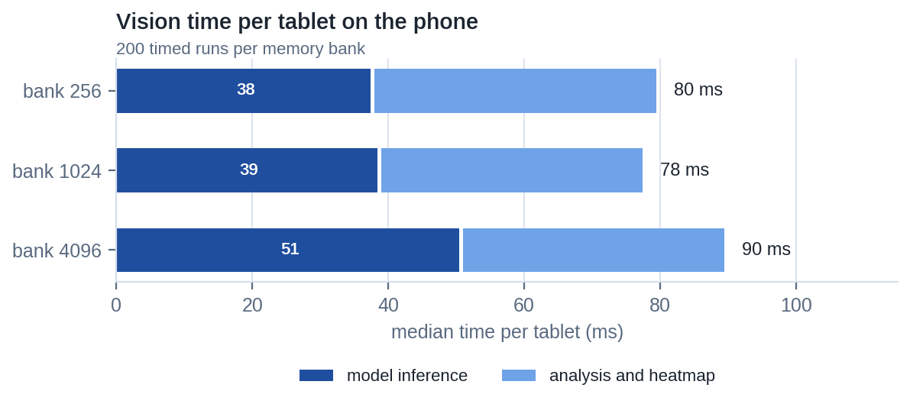

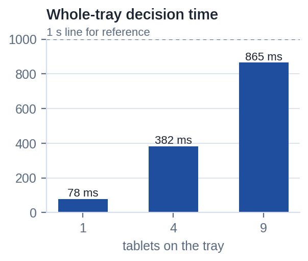
A stop-and-shoot station needs one decision per tray, not video-rate inference. A 9-tablet tray is decided in under one second, faster than an operator can swap trays, and the advice arrives without blocking the next capture.

<!-- BEGIN:throughput -->
| measurement | value | derived | note |
|---|---|---|---|
| full pipeline, replay, 60 s | 9.47 frames/s | 568.2 items/min | replay frames (first 20 non-golden replay images), single-item frames; camera not involved |
| golden parity (device vs PyTorch score) | n = 5 | median rel. diff 1.4%, max 3.4% | difference includes resize (OpenCV INTER_AREA on device vs PIL bilinear-antialias in PyTorch) and fp32 runtime differences |
<!-- END:throughput -->

### Advisory quality and speed

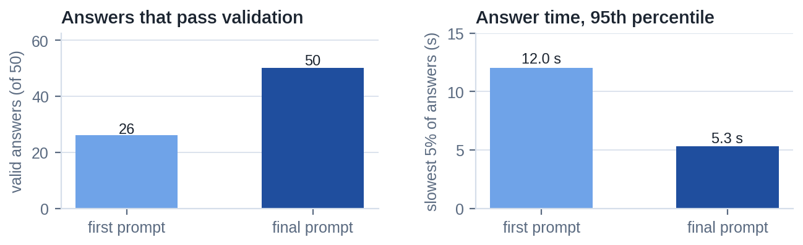

<!-- BEGIN:advisory -->
| run | n | format-valid | manually consistent | TTFT s (median / p95) | decode tok/s (median) | tokens (median) | total s (median / p95 / max) | PSS MB (median) |
|---|---|---|---|---|---|---|---|---|
| v1 prompt seed2026 | 50 | 26/50 | not reviewed | 1.05 / 1.12 | 17.9 | 69 | 5.00 / 12.00 / 37.7 | 1055 |
| v2 prompt seed2027 | 50 | 50/50 | 47/50 | 2.09 / 2.26 | 17.4 | 51 | 4.99 / 5.32 / 6.5 | 1067 |

Model load 2.4 s; app PSS 329 MB before loading Llama, 1167 MB after loading.
<!-- END:advisory -->

The first prompt was tested on one set of 50 cases and improved; the final prompt is reported on 50 new cases.

### Teaching a new product (live camera)

The detector learns "normal" from good tablets only, so a new product can be added without labelling defects.
To show this on real hardware, a paracetamol product was taught from 16 phone photos of two real tablets
(`ml/scripts/07_new_product.py`) and loaded on the phone through a Product switch, without rebuilding the app.

| Step | Result |
|---|---|
| Training data | 6 views of one good tablet, augmented to 205 crops; cropped exactly like the app |
| Held-out good views | scores 2.00 to 3.48 |
| Defective tablets (ink mark, broken halves) | scores 7.70 to 11.88 |
| Live camera, good tablet (19 captures) | scores 3.51 to 4.40, so the pass limit was set to 5.0 |
| Final limits | PASS below 5.0, RE-INSPECT 5.0 to 7.70, REJECT from 7.70 |

With a single good tablet this is a demonstration of the workflow, not a measured accuracy; the accuracy figures
in this report come from the MVTec evaluation above.

## Hardware Utilisation

| Resource | Usage |
|---|---|
| Device | Nothing Phone (3a), Android 17, 8 GB RAM |
| Compute | CPU only for both models; GPU and NPU not used |
| Threads | Vision thread (ONNX Runtime, 4 threads), advisory thread (Llama), camera thread, UI thread |
| Memory | About 330 MB with vision only; about 1.17 GB with Llama loaded (app PSS) |
| Storage | Vision model 11 to 13 MB per bank; Llama model 820.6 MB; tokenizer 2.1 MB |
| Sustained load | Throughput eased from about 4.0 to 3.1 frames per second as the phone warmed from 31 °C to 42 °C (chart below) |

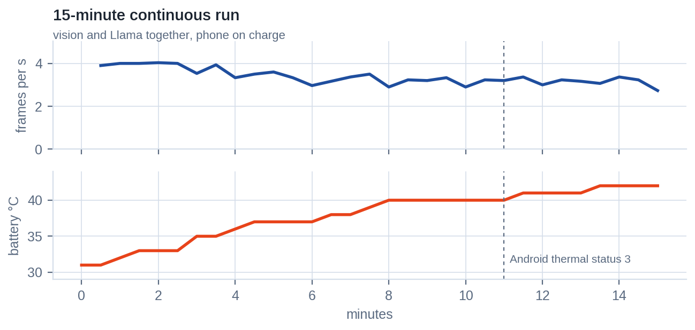

## Optimisation Techniques

| Area | Technique | Effect |
|---|---|---|
| Vision model | ResNet-18 instead of WideResNet-50, 128-dimension projection, coreset memory bank | Phone-sized model with three accuracy/speed options |
| Vision runtime | Whole model exported as one ONNX graph, fixed input, batch 1 | One model call per tablet |
| Pipeline | Quality gate and item finder run before the model; PASS items skip Llama | No wasted inference |
| Capture | Inspect only when the scene is still | No continuous video load |
| Llama size | ExecuTorch 8-bit activations, 4-bit weights (group 32), 4-bit embeddings | 1B model in 820.6 MB |
| Llama runtime | XNNPACK backend, KV cache, SDPA custom op, 1024-token context | About 17 tokens per second on the CPU |
| Llama output | Pre-filled first line, early stop after four lines, token cap | Slowest 5% of answers went from 12.0 s to 5.3 s |
| Scheduling | Bounded queue, rejects first, timeout with template fallback | The line never waits for the language model |

## Conclusion

Pharma Inspector shows that a single mid-range phone can find, judge and explain tablet defects entirely
offline. Next steps are a counted test on real tablets, power measurements, a trained defect-type classifier and
a port to Raspberry Pi 5 with a Hailo accelerator.

The app produces illustrative engineering guidance, not GMP or regulatory advice.

## Appendix

### A. Data split

<!-- BEGIN:dataset -->
train_good 241 (model fitting), val_good 26 (calibration); MVTec test split into calib 81 / eval 86 (seed 42, stratified).

| MVTec test class | total | calib | eval |
|---|---|---|---|
| color | 25 | 12 | 13 |
| combined | 17 | 8 | 9 |
| contamination | 21 | 10 | 11 |
| crack | 26 | 13 | 13 |
| faulty_imprint | 19 | 9 | 10 |
| good | 26 | 13 | 13 |
| pill_type | 9 | 4 | 5 |
| scratch | 24 | 12 | 12 |
<!-- END:dataset -->

### B. Calibration

<!-- BEGIN:calibration -->
| bank | calib image AUROC | t_pass (P5 defective) | t_reject (P95 good) | t_pix | pixel F1 (calib) | severity area cuts |
|---|---|---|---|---|---|---|
| 256 | 0.894 | 4.431 | 4.914 | 4.438 | 0.725 | 0.79% / 1.47% |
| 1024 | 0.946 | 3.523 | 3.998 | 3.622 | 0.746 | 0.85% / 1.86% |
| 4096 | 0.949 | 2.906 | 3.391 | 3.023 | 0.759 | 0.94% / 2.04% |
<!-- END:calibration -->

### C. Results per defect class

<!-- BEGIN:per_class -->
| eval class | n | PASS | RE-INSPECT | REJECT | rate |
|---|---|---|---|---|---|
| color | 13 | 0 | 2 | 11 | flagged 13/13 |
| combined | 9 | 0 | 2 | 7 | flagged 9/9 |
| contamination | 11 | 0 | 2 | 9 | flagged 11/11 |
| crack | 13 | 2 | 3 | 8 | flagged 11/13 |
| faulty_imprint | 10 | 0 | 2 | 8 | flagged 10/10 |
| good | 13 | 10 | 2 | 1 | false alarms 3/13 |
| pill_type | 5 | 0 | 0 | 5 | flagged 5/5 |
| scratch | 12 | 2 | 1 | 9 | flagged 10/12 |
<!-- END:per_class -->

### D. Robustness tests (synthetic frames)

<!-- BEGIN:testcases -->
All frames are synthetic (MVTec tiles on a matched background). 17/20 pass.

| id | scenario | expected | observed | result |
|---|---|---|---|---|
| F1 | Empty tray | NO_ITEMS | NO_ITEMS (place items) | PASS |
| F2 | Blurred frame | BAD_IMAGE (blur) | BAD_IMAGE (blur) | PASS |
| F3a | Too dark | BAD_IMAGE (dark) | BAD_IMAGE (dark) | PASS |
| F3b | Too bright | BAD_IMAGE (bright) | BAD_IMAGE (bright) | PASS |
| F4 | Glare patch | BAD_IMAGE (glare) | BAD_IMAGE (glare) | PASS |
| I1 | One good item | 1 item, OK, PASS | #1 OK PASS | PASS |
| I2 | One defective item | 1 item, RE-INSPECT or REJECT | #1 OK REJECT | PASS |
| I3 | Mixed tray 2x2 | 4 items inspected; verdicts compared with single-image runs | #1 OK REJECT; #2 OK PASS; #3 OK REJECT; #4 OK REJECT / agreement with single-image eval verdicts 4/4 | PASS |
| I3 | Mixed tray 3x3 | 9 items inspected; verdicts compared with single-image runs | #1 OK REJECT; #2 OK PASS; #3 OK RE-INSPECT; #4 OK RE-INSPECT; #5 OK REJECT; #6 OK RE-INSPECT; #7 OK REJECT; #8 | PASS |
| I4 | Touching items | CLUSTER, not inspected | #1 CLUSTER | PASS |
| I5 | Item cut by frame edge | PARTIAL for the cut item; other item inspected | #1 OK PASS; #2 PARTIAL | PASS |
| I6 | Foreign objects | UNKNOWN_OBJECT for both objects, never PASS | #1 OK PASS; #2 UNKNOWN_OBJECT; #3 UNKNOWN_OBJECT | PASS |
| I6b | Dark foreign object on dark fixture (known limitation) | UNKNOWN_OBJECT | #1 OK PASS | FAIL |
| I7 | More than 12 items | 12 inspected, 4 TOO_MANY | #1 OK PASS; #2 OK PASS; #3 OK PASS; #4 OK PASS; #5 OK PASS; #6 OK PASS; #7 OK PASS; #8 OK PASS; #9 OK PASS; #1 | PASS |
| I8 | Wrong product (capsule) | UNKNOWN_OBJECT | #1 CLUSTER | FAIL |
| I9 | Mixed tray with cluster | 3 inspected + 1 CLUSTER needing attention | #1 OK PASS; #2 OK PASS; #3 OK PASS; #4 CLUSTER | PASS |
| I10.0 | Near-threshold calib defect | RE-INSPECT (calib score in band) | #1 OK RE-INSPECT score 3.0923638 | PASS |
| I10.1 | Near-threshold calib defect | RE-INSPECT (calib score in band) | #1 OK REJECT score 3.6350985 | FAIL |
| I10.2 | Near-threshold calib defect | RE-INSPECT (calib score in band) | #1 OK RE-INSPECT score 3.1241007 | PASS |
| I10.3 | Near-threshold calib defect | RE-INSPECT (calib score in band) | #1 OK RE-INSPECT score 3.2004256 | PASS |
<!-- END:testcases -->

### E. Latency tables

<!-- BEGIN:vision_latency -->
Nothing Phone (3a), ONNX Runtime 1.23.2 on CPU (4 threads), 200 timed runs after 20 warm-up runs.

| bank | n | inference ms (median / p95) | post-processing ms (median / p95) | total per item ms (median / p95) |
|---|---|---|---|---|
| 256 | 200 | 38 / 44 | 42 / 45 | 80 / 87 |
| 1024 | 200 | 39 / 43 | 39 / 42 | 78 / 84 |
| 4096 | 200 | 51 / 59 | 39 / 44 | 92 / 103 |
<!-- END:vision_latency -->

<!-- BEGIN:frame_latency -->
Single replay frame each (n = 1 per row), bank 4096. Frame time covers gate, item finder, crops, and vision plus analysis per item; it excludes image decoding.

| frame | items inspected | frame ms | sum of vision ms | frame ms per item |
|---|---|---|---|---|
| 1 item | 1 | 78 | 52 | 78 |
| 4 items | 4 | 382 | 207 | 96 |
| 9 items | 9 | 865 | 463 | 96 |

Across the 86 single-item eval frames: vision median 55 ms (p95 72), frame median 116 ms (p95 144).
<!-- END:frame_latency -->

### F. 15-minute run

<!-- BEGIN:longrun -->
| measurement | value |
|---|---|
| duration / frames | 900 s / 3041 |
| throughput first 2 min / last 2 min | 4.0 / 3.1 frames/s |
| battery temperature start / end | 31.0 / 42.0 C |
| max Android thermal status (first time >= 3) | 3 (660 s) |
| PSS max | 1232 MB |
| advisory queue depth (end) | 5 |
| battery | 100% -> 100% (charging: power not measured) |

Source: `results/device/longrun_15min_20261122_232431.csv`.
<!-- END:longrun -->

### G. Reproducibility and licences

- Build, run and reproduce: `README.md`. Every table and chart here is regenerated with `python bench/make_tables.py` and `python bench/make_figures.py`;
  the PDF with `python report/build_pdf.py`. Decisions with reasons: `docs/DECISIONS.md`.
- MVTec AD is CC BY-NC-SA 4.0 (non-commercial); images are not included in the repository.
- Llama 3.2 is licensed under the Llama 3.2 Community License, Copyright © Meta Platforms, Inc. All Rights
  Reserved. Built with Llama.
